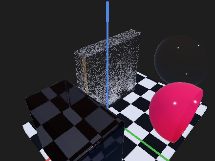
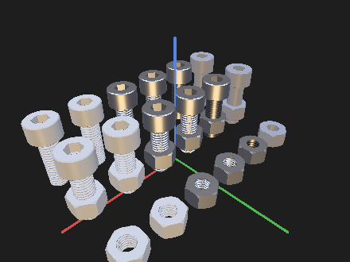
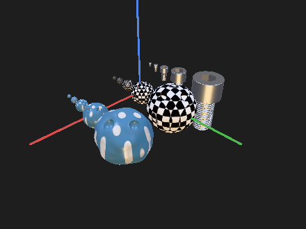
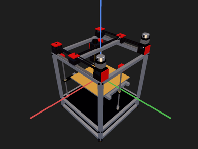
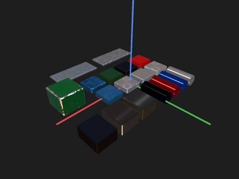
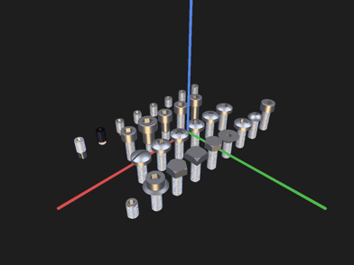
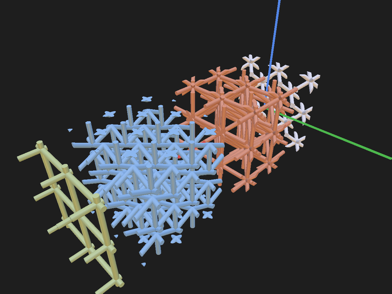
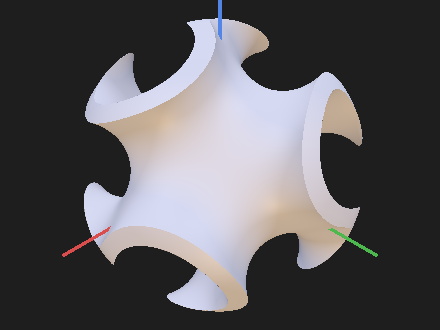

# Omega Core SDK (`omega-core`)

[](https://github.com/Gradient-Control-Laboratories/omega-core/actions/workflows/check.yml)
[](https://github.com/Gradient-Control-Laboratories/omega-core/actions/workflows/wheels.yml)

<p align="center">
  <a href="doc/assets/showcase/glass.png"></a>
  <a href="doc/assets/showcase/fastener_cosmetics.png"></a>
  <a href="doc/assets/showcase/detail_ladder.png"></a>
  <a href="doc/assets/showcase/corexy_printer.png"></a>
  <br>
  <a href="doc/assets/showcase/material_coated.png"></a>
  <a href="doc/assets/showcase/fastener_matrix.png"></a>
  <a href="doc/assets/showcase/beam_lattice_gallery.png"></a>
  <a href="doc/assets/showcase/gyroid.png"></a>
</p>

`omega-core` is the standalone Go SDK for the Geometric Shape Language (GSL). It provides
pure, modular compiler libraries and the `gsl` command-line toolchain (`compile`, `serve`, `fix`)
for parsing, analyzing, refactoring, and compiling GSL models into WebGPU compute shaders (WGSL),
3D meshes (STL), bytecode tapes, and audio synthesizers.

<table>
  <tr>
    <td valign="top">
      <strong>Video Demo — Interactive WebGPU Viewer</strong><br><br>
      Watch a short walkthrough of the <code>gsl serve</code> / <code>gsl viewer</code> example viewer in action.<br><br>
      Watch on YouTube: <a href="https://youtu.be/wlTj_TXmRJk">https://youtu.be/wlTj_TXmRJk</a>
    </td>
    <td align="right" valign="middle" width="340">
      <a href="https://youtu.be/wlTj_TXmRJk">
        
      </a>
    </td>
  </tr>
</table>

## Architecture & Package Topology

- **`parser/`**: Stateless GSL lexer, parser, and AST generator.
- **`assembler/`**: Multi-package linker, type checker, inliner, constant evaluator, and optimizer.
- **`program/`**: Canonical AST definitions, type systems, and visitor models.
- **`eval/`**: Certified spatial and interval evaluator (`gsl eval`, `Evaluator` Go API, Python SDK).
- **`backend/`**:
  - `wgsl/`: WGSL compute shader emitter for real-time GPU SDF raymarching.
  - `mesh/`: Unified 3D mesh generator coordinating dual-contouring (Fidget) and CSG (Manifold).
  - `audio/`: Audio synthesizer compiler emitting WebAudio / JavaScript synthesis functions.
  - `tape/`: Bytecode tape compiler for compact embedded geometry evaluation.
- **`stdlib/`**: Compile-time embedded GSL standard library packages (`builtin`, `color`, `vector`, `matrix`, etc.).
- **`cmd/gsl/`**: Unified GSL toolchain CLI driver (`gsl <command> [args]`).
- **`cmd/compile/`**: Standalone multi-backend command-line compiler (`gsl compile`).
- **`cmd/serve/`**: Local HTTP server and interactive WebGPU viewer host (`gsl serve`).
- **`cmd/fix/`**: Source refactoring tool for migrating legacy GSL syntax (`gsl fix`).

### Directory Layout

```text
omega-core/
├── go.mod                     # module github.com/Gradient-Control-Laboratories/omega-core
├── assembler/
│   ├── assemble.go            # Assemble(primarySources, opts...) API
│   ├── options.go             # Options (SourcePath, SourceManager, WithProgress...)
│   └── source/                # Source abstraction
├── backend/                   # Target code generators
│   ├── audio/                 # Web Audio synthesis generator
│   ├── mesh/                  # Unified 3D mesh generator
│   ├── tape/                  # Bytecode tape compiler
│   └── wgsl/                  # WebGPU shader emitter
├── bin/                       # Local build outputs (gsl, compile, serve, fix binaries; gitignored)
├── cmd/                       # Standalone CLI tools
│   ├── compile/               # Unified compiler CLI (emits WGSL, STL, 3MF, GLB, tape, audio)
│   ├── fix/                   # GSL source refactoring CLI (rewrites legacy comments to directives)
│   ├── gsl/                   # Unified GSL toolchain CLI driver (delegates to bin/ tools)
│   └── serve/                 # Local HTTP server and WebGPU viewer host
├── examples/                  # Curated showcase GSL models and assets
│   ├── assets/                # Traditional CAD mesh assets (bracket.stl)
│   └── viewer/                # Interactive WebGPU example viewer web application
│       ├── docs/              # Built-in GSL language reference and interactive help panel
│       ├── editor/            # CodeMirror 6 GSL/WGSL editor, autocomplete, and search
│       ├── fonts/             # Self-hosted UI (PublicSans) and code (IBMPlexMono) fonts
│       ├── icons/             # SVG toolbar and inspector icons
│       ├── materials/         # PBR material catalog, BRDF lookup tables, and swatches
│       └── vendor/            # Vendored browser libraries (Three.js, CodeMirror, Manifold)
├── parser/                    # Lexer and Parser
├── program/                   # Core Program/AST models and definitions
│   ├── program.proto          # Protobuf AST schema definitions
│   └── scene/                 # Scene descriptor construction and extent utilities
├── stdlib/                    # GSL Standard Library
│   ├── pkg_info.go            # Package registry and compile-time embedded source data
│   ├── builtin/
│   ├── color/
│   ├── ...
│   ├── transform/
│   └── vector/
└── tool/                      # Developer build and automation scripts
    ├── analyze-deps/          # Architectural dependency invariant checker
    ├── build-cli.sh           # Builds compiler CLI executables (gsl, compile, serve, fix) into bin/
    ├── build-fidget.sh        # Builds Fidget and Manifold Rust/C++ native and WASM artifacts
    ├── build-proto.sh         # Compiles program.proto and tape.proto into Go bindings
    ├── build-wgsl-accel-ops.sh # Regenerates WGSL hardware acceleration ops table and inliner registry
    ├── check.sh               # Pre-commit quality gate (gofmt, analyze-deps, go vet, tests)
    ├── clean.sh               # Cleans bin/ outputs, test cache, and scratch files
    ├── ensure-native-libs.sh  # Downloads or builds librender & libmanifold_glue for the host OS/arch
    ├── test-go.sh             # Runs Go unit, integration, and golden test suites
    ├── test-rust.sh           # Runs Rust unit and doc test suites
    ├── test.sh                # Runs both Go and Rust test suites
    ├── update-goldens.sh      # Regenerates reference test goldens
    └── run-go-tests/          # Go test suite runner, timing history, and golden size reporter
```

## Using `omega-core` as a Go SDK

Add `omega-core` to a downstream Go module (`omega-release`, `dm_omega`, etc.) directly from GitHub:

```bash
go get github.com/Gradient-Control-Laboratories/omega-core
go mod vendor   # optional: vendor omega-core into your consumer module
```

Pure-Go packages (`parser`, `assembler`, `program`, `stdlib`, `backend/wgsl`, `backend/audio`,
`backend/tape`) compile with zero native dependencies. Consumers that link cgo-backed meshing
(`backend/mesh`, `backend/mesh/manifold`) can provision `librender` and `libmanifold_glue` via
`./tool/ensure-native-libs.sh` (or the reusable `.github/workflows/build-native-libs.yml` workflow
in GitHub Actions) and pass their directory via `CGO_LDFLAGS` and `LD_LIBRARY_PATH` /
`DYLD_LIBRARY_PATH`.

## Building the Toolchain

Compile the `gsl`, `compile`, `serve`, and `fix` binaries into `bin/`:

```bash
./tool/build-cli.sh
```

Run pre-commit quality checks (gofmt, go vet, and tests):

```bash
./tool/check.sh
```

Run unit and integration test suites:

```bash
./tool/test.sh
```

Clean build outputs and test cache:

```bash
./tool/clean.sh
```

## Toolchain Driver (`bin/gsl`) Usage

```text
gsl <command> [arguments]
```

Subcommands delegate to sibling tool binaries in `bin/`:
- `gsl compile` (aliases `build`, `c`): Compile GSL sources to target outputs (`bin/compile`).
- `gsl serve`: Launch the local HTTP server and interactive WebGPU viewer (`bin/serve`).
- `gsl viewer [part.gsl]`: Open a file, or the examples, in the WebGPU viewer in the default browser
  (`bin/compile viewer`); the file's folder is served, and Save writes back to it.
- `gsl export part.gsl [more.gsl ...] -o dir`: Write the viewer and the files' compiled fields as a folder of
  static web pages that needs no server of ours (`bin/compile export`); the page shows the source read-only.
- `gsl fix`: Refactor GSL source files to current syntax (`bin/fix`).
- `gsl help [command]`: Display help for `gsl` or a specific subcommand.

### Supported Compiler Targets (`-t, --target`)

- `wgsl`: WebGPU signed distance field shader code (default).
- `stl`: 3D printable watertight binary polygon mesh via dual-contouring.
- `tape`: Compact vectorized spatial bytecode evaluation tape.
- `audio`: Web Audio JavaScript oscillator and synthesis code.
- `ast`: Formatted JSON AST dump for structural inspection.
- `field`: The field bundle a viewer draws, as one JSON (`<source>.field.json`): the WGSL with its shapes,
  parts, sliders, UI controls, `@scene` and imported meshes' preview grids, the same as `gsl serve`'s
  `/api/compile` answers. A document with errors gets a bundle listing them, and the command exits 1.

### Companion Metadata (`<output>.json`)

When compiling to output artifacts (such as `.wgsl` or `.stl`), `gsl compile` automatically emits a
companion `<output>.json` metadata file alongside the output. This document includes:
- Extracted `@slider` definitions (names, min, max, initial values, and precision).
- Extracted UI controls and layout descriptors.
- Scene bounding box dimensions and camera presets.
- Non-fatal compiler diagnostics and warning spans.

To specify a custom metadata destination, pass `-m <file>`. To disable companion metadata emission,
pass `--no-meta`.

### Common Workflow Examples

Compile a model to a WebGPU shader with auto-emitted `model.json` metadata:

```bash
bin/gsl compile -t wgsl -o model.wgsl model.gsl
```

Compile a standalone WebGPU shader bundle with full-screen raymarcher harness (`vs_main`, `fs_main`):

```bash
bin/gsl compile --standalone -o preview.wgsl model.gsl
```

Compile a model into a watertight binary STL mesh:

```bash
bin/gsl compile -t stl --subdivision 5 --algo marching-cubes -o model.stl model.gsl
```

Each top-level return is meshed as its own body, so bodies that touch are not welded together. A model
with several returns gives a zip of one STL per body (`-o model.zip`, named after the source by default),
or, with `-t 3mf`, one 3MF with each body an object in its own color:

```bash
bin/gsl compile -t 3mf -o model.3mf model.gsl
```

`-t glb` writes one binary glTF with each body a node in its own color, for Blender, three.js and other
3D tools. The vertices stay in millimetres with Z up, as in the STL and 3MF; a root node scales them to
glTF's metres and turns them Y up, so the part opens at its size and the right way up:

```bash
bin/gsl compile -t glb -o model.glb model.gsl
```

Compile from standard input (`stdin`) and stream to standard output (`stdout`):

```bash
cat model.gsl | bin/gsl compile -t wgsl -o -
```

Refactor `.gsl` files or directories in-place (or preview with `-diff`):

```bash
bin/gsl fix -diff examples
bin/gsl fix examples
```

## Language Specification & Roadmap

- [Current GSL Language Specification](doc/gsl_lang_spec_current.md) — implemented GSL syntax,
  annotations, directives, properties, and built-ins
- [Future GSL Language Specification](doc/gsl_lang_spec_future.md) — target GSL v2 design
- [Roadmap](doc/roadmap.md) — completed highlights and planned language, compiler, evaluator, and
  backend work
- [Changelog](CHANGELOG.md) — full release history and unreleased changes on `main`
- [Compiler Architecture & Execution Pipeline](doc/compiler-arch.md) — AST, linking, lowering,
  constant folding, and backend emission overview

## License

The code and data authored for this repository are released under the [MIT License](LICENSE).
Third-party components keep their own licenses: they are listed, with their license texts, in
[THIRD_PARTY_NOTICES.md](THIRD_PARTY_NOTICES.md), and the vendored directories carry their own
license files (for example `internal/fidget/vendor/`, which is MPL-2.0).
