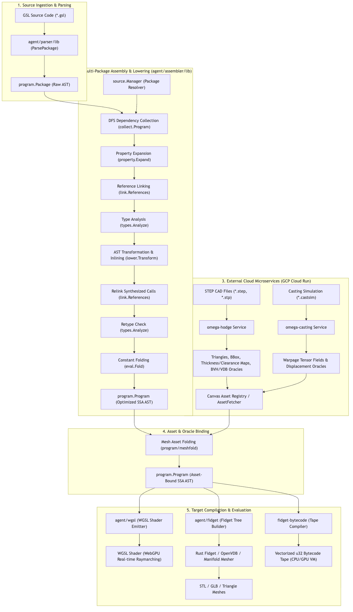
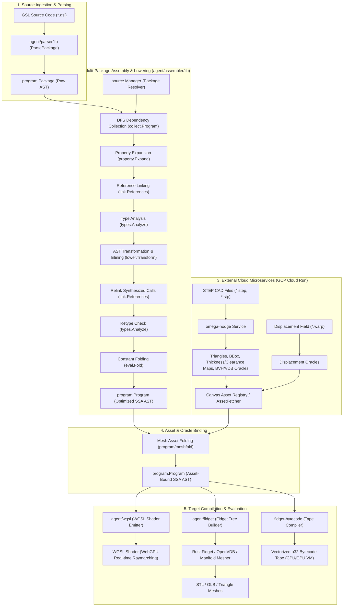

# GSL Compiler Architecture & Execution Pipeline

This document describes the compilation architecture of the Omega CAD ecosystem.
It details the information flow from GSL (GCL Shape Language) source code
through abstract syntax tree (AST) generation, linking, lowering, constant folding,
and target emission for real-time rendering, geometry meshing, and evaluation tapes.
It also describes how the external `omega-hodge` microservice and imported
displacement fields integrate into the asset resolution and oracle evaluation
pipeline.

---

## High-Level Architecture Flow

The following diagram illustrates the complete compilation lifecycle across all layers:

Mermaid Diagram Source

---

## 1. Source Ingestion & Parsing

1. **GSL Source Code**:
   GSL is an immutable, expression-oriented Single Static Assignment (SSA) language
   designed for signed distance function (SDF) geometric modeling.
2. **Parser (`agent/parser/lib`)**:
   The parser uses a grammar built on `participle` to parse package sources into a typed
   [`program.Package`](../common/program/program.go) AST.
   Syntax errors and lexical issues are returned as joined Go `error` values.
3. **Standard Library Pre-Registration**:
   During initialization (`init()`), the standard packages (`"color"`, `"ease"`, `"gears"`,
   `"lattice"`, `"domain"`, `"matrix"`, `"noise"`, `"text"`, `"vector"`) are parsed and registered
   in the global package registry.

---

## 2. Assembly & Lowering Pipeline (`agent/assembler/lib`)

The assembler coordinates multi-package dependency gathering, semantic analysis, and optimizations:

1. **Package Collection & Initial Linking (`collect`, `link`)**:
   Performs a depth-first search (DFS) traversal over explicit imports and auto-injected references,
   resolving source dependencies through `source.Manager`, linking references, and carrying properties.
2. **Closure & Higher-Order Function Transformation (`closure`)**:
   Hoists closures and converts higher-order function patterns to first-order representations.
3. **Property Expansion & Initial Type Analysis (`property`, `types`)**:
   Expands syntactic property expressions, marks parts, and validates operand types.
4. **Pre-Lowering Constant Evaluation & Structural AST Lowering (`eval.Fold`, `lower`)**:
   Runs an initial constant folding pass (`eval.Fold` with `assemblerParamChecker`) to reduce constant
   collections and sizes, then lowers high-level language constructs (`map`, `reduce`) into canonical
   `Operation_COLLECT` expressions.
5. **Domain-Specific Folding (`meshfold`, `topofold`, `warpfold`)**:
   Executes pluggable domain fold passes for mesh asset slots, topology geometry, and space warps.
6. **Iterative Fixed-Point Optimization (`optimizeProgram`)**:
   Runs an iterative optimization loop re-sequenced to:
   Inlining (`inline`) -> Constant Folding (`eval.Fold`) -> Lowering (`lower`, `unroll`) -> Dead Code (`deadcode`).
7. **Final Dead Code Elimination (`deadcode`)**:
   Sweeps all packages to eliminate unused functions, variables, and imports.

Frontend reflection (`ExtractUI` option) conditionally extracts sliders (`slider.Extract`),
UI controls (`ui.Extract`), and scene metadata (`prog.Scene()`) directly onto `assembler.Response`
during assembly, eliminating redundant AST re-traversals in downstream agents.

---

## 3. External Microservices Integration

Omega integrates an external cloud service running on GCP Cloud Run
to handle heavy CAD asset conversions:

### `omega-hodge` Microservice
- **Purpose**: Ingests B-Rep STEP CAD files (`*.step`, `*.stp`)
  and compiles them into raymarchable SDF assets.
- **Outputs**:
  - Triangulated surface meshes and axis-aligned bounding boxes (AABB).
  - Part-frame transformation matrices (`toLocal`, `fromLocal`).
  - Hodge surface-analysis property maps (wall thickness and clearance analysis).
  - Bounding Volume Hierarchy (BVH) and OpenVDB narrow-band distance grid oracles
    (`bvhSdf`, `vdbSdf`).
- **Information Flow**:
  When a document declares `importStep "part.stp"` or `importMesh "mesh.stl"`,
  the Canvas Agent queries `omega-hodge` to bake mesh oracles
  and returns slot registrations to the compiler.

### Imported displacement fields
- **Purpose**: A precomputed displacement field (`*.warp`) deforms an imported part.
- **Information Flow**:
  Documents using `importWarp "field.warp"` bind deformation oracle IDs to `meshWarped`
  and `vdbSdfWarped` expressions, allowing the downstream geometry engine to deform parts
  during meshing and evaluation. No service computes the field; it is an asset the
  document supplies.

---

## 4. Asset & Oracle Binding (`common/program/meshfold`)

Before emitting target code, expressions referencing imported STEP CAD parts or warpage simulations
(`importStep`, `importMesh`, `importWarp`) are folded into literal asset slot indices.
Oracle payloads (mesh vertex buffers and VDB voxel grids)
are registered with the evaluation runtime.

---

## 5. Target Code Generation & Emission

Once the AST is assembled, lowered, and bound to asset slots,
it can be emitted to three distinct targets:

### A. WGSL Shader Target (`agent/wgsl`)
- **Use Case**: Real-time browser rendering and live interactive canvas editing.
- **Mechanism**: Translates the SSA AST
  into WebGPU Shading Language (WGSL) compute/fragment shaders.
- **Features**: Extracts interactive UI sliders (`slider.Extract`),
  generates analytic raymarching loops, and handles multi-material surface shading.

### B. STL / Geometry Meshing Target (`agent/fidget`)
- **Use Case**: High-resolution 3D mesh export (STL, GLB, 3MF) and solid manufacturing models.
- **Mechanism**: Converts the AST into Fidget CSG operator trees
  and invokes the Rust `fidget-mesh` engine with OpenVDB and Manifold boolean processing
  to extract watertight triangle surfaces.

### C. Bytecode Tape Target (`agent/fidget` / `fidget-bytecode`)
- **Use Case**: High-throughput vectorized spatial evaluation for simulation and gradient probing.
- **Mechanism**: Compiles the AST into a linear `u32` bytecode tape
  executed by optimized VM evaluators on CPU (AVX2/NEON) and GPU compute kernels.

### Shared Backend Visitor & Code Generator (`common/build`)
- **Single Responsibility**: Serves strictly as a shared backend visitor and code generator
  for target emitters (such as `agent/wgsl` and `agent/js`).
- **Architectural Boundary**: Must remain free of semantic analysis, check delegates,
  and compiler diagnostic generation.
  All AST validation, reference linking, scope checking, and diagnostic reporting
  are performed upstream during multi-package assembly (`agent/assembler/lib` and `common/program/*`).
  Target backends consume verified, unambiguous ASTs produced by the assembler.

---

## 6. Compiler Performance & Design Principles

The GSL compilation pipeline adheres to specific optimization and complexity trade-offs:

1. **Fast-Path for Valid, Error-Free Programs**:
   Compilation speed and minimal memory allocations are paramount for valid programs.
   Interactive CAD editing, canvas dragging, and shader re-compilation operate on the clean path.
   Fast paths must exit early (e.g. `len <= 1` checks for dot imports, direct map lookups),
   avoid unnecessary defensive branching, and avoid heap allocations.

2. **Reduced Code Complexity Over Premature Guards**:
   Prefer simpler control flow and unified code paths over defensive conditionals.
   For example, utility functions like `link.References` delegate directly to
   `link.ReferencesAndDiagnostics` without conditional `if sink != nil` checks,
   keeping linking logic singular and straightforward.

3. **Asymmetric Performance Budget for Errors and Diagnostics**:
   It is entirely acceptable for the compiler to spend additional CPU cycles,
   allocate diagnostic deduplication tables, format messages, and perform deeper analysis
   when processing programs that contain warnings or errors.
   Diagnostic reporting and error formatting are never on the interactive hot path.

